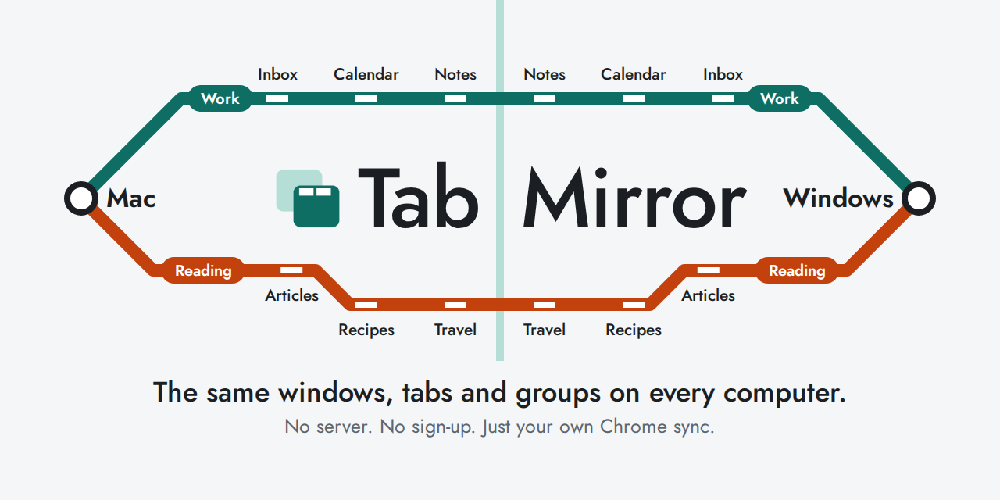
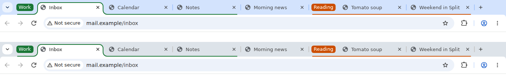
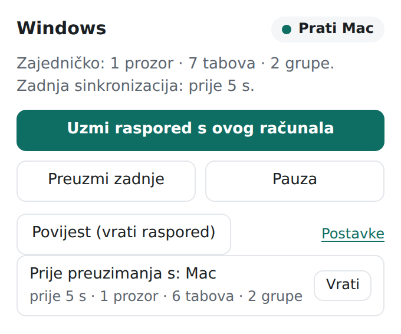
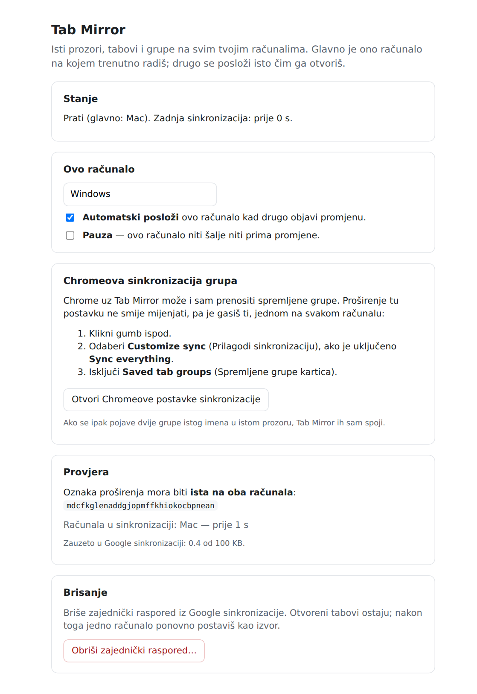

<p align="center">
  
</p>

<p align="center">
  <a href="README.md">English</a> · <b>Hrvatski</b>
</p>

# Tab Mirror

U uredu radiš na Macu, a doma na Windowsu. Tab Mirror drži iste Chrome prozore, tabove i grupe na oba računala, bez ikakvog klikanja.

Glavno je ono računalo na kojem trenutno radiš, a drugo se samo posloži isto. Sve ide kroz Chromeovu sinkronizaciju tvog Google računa, pa nema servera, registracije ni troška.

<p align="center">
  <br>
  <sub>Dva odvojena preglednika s pravim proširenjem i izmišljenim stranicama. Isti tabovi, isti redoslijed, iste grupe.</sub>
</p>

> **Prije instalacije:**
> - Proširenje nije u Chrome Web Storeu. Instaliraš ga ručno i ručno ga nadograđuješ.
> - Napravljeno je za dva računala. Koristi se na Macu i Windowsu, a Linux i ChromeOS nisu isprobani.

## Što se prenosi

| Prenosi se | Ne prenosi se |
|---|---|
| Prozori i tabovi, istim redom | Ono što je unutar stranice (gdje si stao, upisan tekst, video) |
| Web adrese (`http`, `https`) | Lokalne datoteke (`file://`) |
| Grupe tabova: naziv, boja, otvorena ili sklopljena | Prijave na stranice i kolačići |
| Zakvačeni tabovi i aktivni tab | Incognito prozori, `chrome://` stranice, stranice drugih proširenja |

Na stranice se prijavljuješ posebno na svakom računalu. Tab koji na drugom računalu traži prijavu ostaje jedan tab, a stranica za prijavu ne vraća se na računalo na kojem si već prijavljen.

## Instalacija

Treba ti Chrome 120 ili noviji, prijavljen istim Google računom na oba računala, s uključenom sinkronizacijom. Ponovi korake na svakom računalu, traje oko dvije minute.

1. Skini `tab-mirror-<verzija>.zip` sa [zadnjeg izdanja](../../releases/latest).
2. Raspakiraj ga negdje gdje ga nećeš obrisati, npr. u Dokumente. Proširenje je u podmapi `tab-mirror`.
3. Otvori `chrome://extensions` i gore desno uključi **Developer mode**.
4. Klikni **Load unpacked** i odaberi podmapu `tab-mirror`, onu u kojoj je `manifest.json`. Vanjska mapa daje grešku „Manifest file is missing“.
5. Prikvači ikonu: klikni slagalicu u alatnoj traci, pa pribadaču kod Tab Mirrora.

Zatim na oba računala provjeri dvije Chromeove postavke. Otvori `chrome://settings/syncSetup`:

- Ako ne koristiš „Sync everything“, uključi **Extensions**. Bez toga Tab Mirror ne može raditi.
- Isključi **Saved tab groups**. Tab Mirror već prenosi grupe, a ako ih istovremeno prenosi i Chrome, popis spremljenih grupa može se napuniti duplikatima. Proširenja tu postavku ne smiju mijenjati, pa je mijenjaš ti.

## Prvo pokretanje

1. Na računalu čije tabove želiš zadržati nakon instalacije se otvore postavke. Klikni **Ovo računalo je izvor**.
2. Na drugom računalu postavke za nekoliko sekundi do minute ponude taj raspored. Klikni **Preuzmi raspored s računala…**.

Tabovi na drugom računalu kojih nema na prvom se zatvore. Ostaju spremljeni u povijesti, pa ih možeš vratiti.

To je cijelo postavljanje. Od sada sve ide samo.

## Što znače gumbi

Klikni ikonu u alatnoj traci i otvori se izbornik.

<p align="center">
  
</p>

| Gumb | Što radi |
|---|---|
| Uzmi raspored s ovog računala | Ovo računalo odmah postaje glavno |
| Preuzmi zadnje | Posloži ovo računalo prema zadnjem zajedničkom rasporedu |
| Pauza | Ovo računalo prestaje slati i primati |
| Povijest (vrati raspored) | Povratak na raniji raspored |
| Postavke | Naziv računala, pauza, automatsko slaganje |

Oznaka na ikoni govori u kojem je stanju:

| Oznaka | Značenje |
|---|---|
| (ništa) | Sve je u redu |
| `?` | Računalo još nije postavljeno. Otvori postavke. |
| `❚❚` | Pauza |
| `!` | Sukob ili greška. Otvori izbornik i pročitaj. |

<details>
<summary>Kako izgleda stranica postavki</summary>
<br>

</details>

## Ako nešto pođe po zlu

Svako računalo čuva zadnjih 20 rasporeda. Prije nego što promijeni tvoje tabove, Tab Mirror spremi ono što si imao. Za povratak klikni ikonu, zatim **Povijest**, pa **Vrati** kod željenog rasporeda. Taj raspored tada postaje zajednički na oba računala.

Tab Mirror nikad ne dijeli prazan raspored, pa zatvaranje Chromea ili zadnjeg prozora ne može obrisati tabove na drugom računalu.

## Kako radi

Zamisli bilježnicu koju čitaju oba računala, a svako računalo u njoj ima svoju stranicu.

1. Otvoriš, zatvoriš ili premjestiš tab. Oko 1,5 sekundi kasnije Tab Mirror upiše raspored na stranicu tvog računala. Sama promjena aktivnog taba čeka 5 sekundi.
2. Chromeova sinkronizacija odnese bilježnicu na drugo računalo, obično za nekoliko sekundi. Google ne jamči vrijeme, pa ponekad može potrajati i minutu.
3. Drugo računalo pročita najnoviju stranicu i posloži se. Tabove koje već ima samo premjesti, bez ponovnog učitavanja. Novi tabovi otvore se uspavani i učitaju se tek kad klikneš na njih.

Pisati smije samo računalo za kojim stvarno sjediš: Chrome mora biti u fokusu, a ti aktivan u zadnjoj minuti. Tako stranica koja sama promijeni adresu na računalu koje miruje ne može preuzeti vodstvo. Ono što se promijeni dok te nema čeka i šalje se kad se vratiš.

Ako nešto promijeniš na oba računala prije nego što sinkronizacija stigne, tabovi dodani s bilo koje strane ostaju na oba. Tab koji si baš tada zatvorio može se vratiti. Bolje tab viška nego izgubljen tab. Grupe istog imena u istom prozoru spajaju se u jednu, a raspored prije spajanja ostaje u povijesti.

## Privatnost

- Proširenje samo ne radi nikakve mrežne pozive. Nema servera, analitike ni praćenja.
- Raspored, uključujući web adresu svakog otvorenog taba, sprema se u podatke Chromeove sinkronizacije tvog Google računa. Ondje Chrome drži podatke proširenja, što znači da ih Google obrađuje pod tvojim računom. Ako ti to ne odgovara, nemoj koristiti Tab Mirror.
- Ne može čitati sadržaj stranica. Ima samo ove Chromeove dozvole:

| Dozvola | Zašto |
|---|---|
| `tabs`, `tabGroups` | Vidi i slaže tabove i grupe |
| `storage` | Čuva raspored i povijest |
| `idle` | Zna koristiš li ovo računalo |
| `alarms` | Redovito provjerava je li koja promjena propuštena |
| `webNavigation` | Razlikuje preusmjeravanje stranice od poveznice koju si kliknuo |

## Nadogradnja

Automatske nadogradnje nema.

1. Raspakiraj novo izdanje i sadržaj njegove mape `tab-mirror` kopiraj preko postojeće mape `tab-mirror`.
2. U `chrome://extensions` klikni kružnu strelicu (Reload) kod Tab Mirrora.

Postavke, raspored i povijest ostaju. **Nikad ne klikni Remove**, jer to briše povijest i identitet računala.

## Ograničenja

- Chrome proširenjima daje 100 KB prostora za sinkronizaciju. To je dovoljno za oko 500 tabova po računalu, uz dva računala.
- Samo obični prozori. Incognito, prozori aplikacija i razvojnih alata ostaju netaknuti.
- Tab koji sam prijeđe na drugu stranicu dok računalo miruje, npr. na zajedničku prijavu, ostaje kao zaseban tab i prenese se na drugo računalo.

## Za programere

```
npm install        # treba samo za testove u pregledniku (Puppeteer)
npm test           # 88 jediničnih testova
npm run test:e2e   # 27 scenarija na dva prava Chromiuma s lažnom Google sinkronizacijom
npm run build      # dist/tab-mirror-<verzija>.zip
```

Dizajn je opisan u [DESIGN.md](DESIGN.md). Vidi i [CHANGELOG.md](CHANGELOG.md), [CONTRIBUTING.md](CONTRIBUTING.md) i [SECURITY.md](SECURITY.md).

`key` u `manifest.json` daje proširenju istu oznaku na svakom računalu, pa zato računala vide podatke jedno drugoga. To je javni ključ, a privatnog ključa u ovom repozitoriju nema.

## Licenca

[MIT](LICENSE). Slobodno koristi, mijenjaj i dijeli.

Tab Mirror je neovisan projekt, nije povezan s Googleom, Appleom ni Microsoftom niti ga oni podržavaju. Chrome, Mac i Windows zaštitni su znakovi svojih vlasnika.
