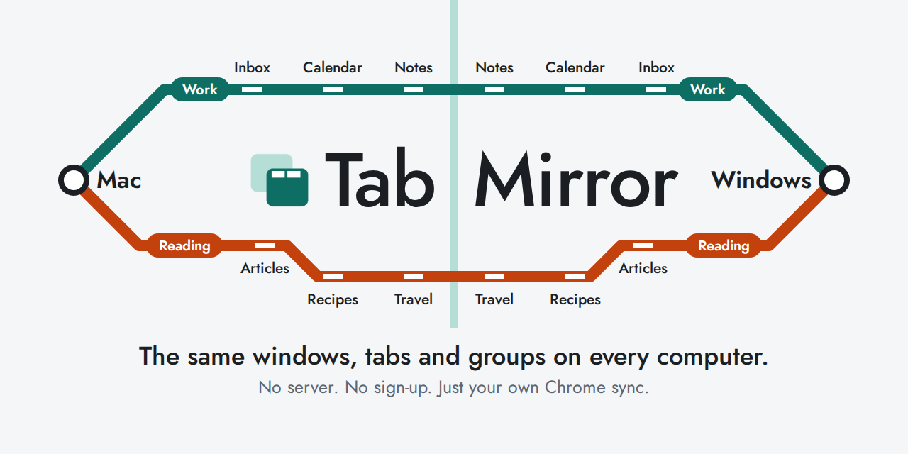
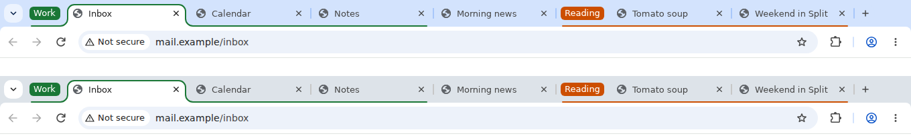
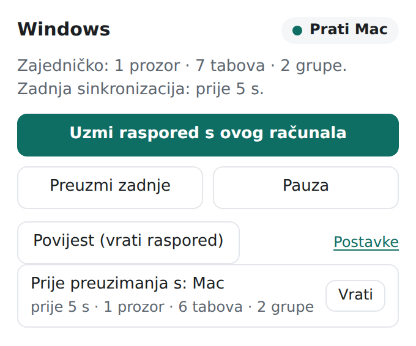
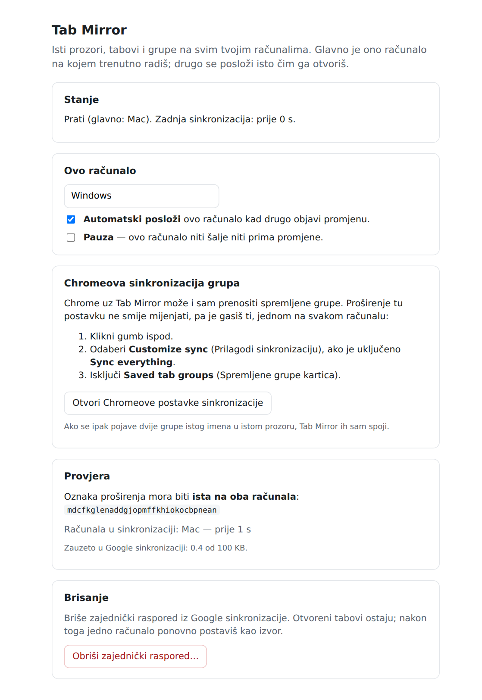

<p align="center">
  
</p>

<p align="center">
  <b>English</b> · <a href="README.hr.md">Hrvatski</a>
</p>

# Tab Mirror

You work on a Mac at the office and a Windows PC at home. Tab Mirror keeps the same Chrome windows, tabs and tab groups on both, without you clicking anything.

Whichever computer you are using right now leads. The other one rearranges itself to match. Everything travels through your own Google account's Chrome sync, so there is no server, no sign-up and no cost.

<p align="center">
  <br>
  <sub>Two separate browsers running the real extension, with made-up sites. Same tabs, same order, same groups.</sub>
</p>

> **Before you install:**
> - The extension's buttons and messages are in Croatian for now. This page tells you what each one means.
> - It isn't in the Chrome Web Store. You install it by hand, and you update it by hand.
> - It is built for two computers. It is used on a Mac and a Windows PC. Linux and ChromeOS are untested.

## What it syncs

| Syncs | Does not sync |
|---|---|
| Windows and tabs, in order | What is inside a page (scroll position, typed text, a playing video) |
| Web addresses (`http`, `https`) | Local files (`file://`) |
| Tab groups: name, colour, open or collapsed | Your logins and cookies |
| Pinned tabs and the active tab | Incognito windows, `chrome://` pages, other extensions' pages |

You stay signed in to sites separately on each computer. A tab that needs a login on the other computer stays one tab, and the login page does not spread back to the computer where you are already signed in.

## Install

You need Chrome 120 or newer, signed in to the same Google account on both computers, with sync turned on. Repeat these steps on each computer. It takes about two minutes.

1. Download `tab-mirror-<version>.zip` from the [latest release](../../releases/latest).
2. Unzip it somewhere you won't delete, such as your Documents folder. The extension is in the `tab-mirror` subfolder.
3. Open `chrome://extensions` and turn on **Developer mode** (top right).
4. Click **Load unpacked** and choose the `tab-mirror` subfolder, the one that contains `manifest.json`. Choosing the outer folder gives a "Manifest file is missing" error.
5. Pin the icon: click the puzzle piece in the toolbar, then the pin next to Tab Mirror.

Then check two Chrome settings on both computers. Open `chrome://settings/syncSetup`:

- If you don't use "Sync everything", turn on **Extensions**. Tab Mirror can't work without it.
- Turn off **Saved tab groups**. Tab Mirror already carries your groups, and Chrome doing the same at once can fill its saved groups list with duplicates. Extensions aren't allowed to change this setting, so it's up to you.

## First run

1. On the computer whose tabs you want to keep, the settings page opens after you install. Click **Ovo računalo je izvor** ("this computer is the source").
2. On the other computer, within a few seconds to a minute, the settings page offers to take that layout. Click **Preuzmi raspored s računala…** ("take the layout from…").

Tabs on the second computer that aren't on the first will close. They are saved in the history, so you can bring them back.

That's the whole setup. From now on it runs by itself.

## What the buttons mean

Click the toolbar icon to open the menu.

<p align="center">
  
</p>

| In the extension | In English | What it does |
|---|---|---|
| Uzmi raspored s ovog računala | Use this computer's layout | This computer becomes the leader right now |
| Preuzmi zadnje | Get the latest | Arrange this computer to match the latest shared layout |
| Pauza | Pause | This computer stops sending and receiving |
| Povijest (vrati raspored) | History (restore a layout) | Go back to an earlier layout |
| Postavke | Settings | Computer name, pause, automatic arranging |

The icon's badge tells you the state:

| Badge | Meaning |
|---|---|
| (none) | All good |
| `?` | This computer isn't set up yet. Open settings. |
| `❚❚` | Paused |
| `!` | A conflict or an error. Open the menu to read it. |

<details>
<summary>What the settings page looks like</summary>
<br>

</details>

## If something goes wrong

Each computer keeps its last 20 layouts. Before Tab Mirror changes your tabs, it saves what you had. To go back, click the icon, then **Povijest**, then **Vrati** ("restore") next to the layout you want. The layout then becomes the shared one on both computers.

Tab Mirror also never shares an empty layout, so closing Chrome or your last window can't wipe your tabs on the other computer.

## How it works

Think of a notebook that both computers can read, with a separate page for each computer.

1. You open, close or move a tab. About 1.5 seconds later, Tab Mirror writes your layout on your computer's page. A change of active tab alone waits 5 seconds.
2. Google's Chrome sync carries the notebook to your other computer, usually within seconds. Google doesn't promise a time, so it can occasionally take a minute.
3. The other computer reads the newest page and rearranges itself. Tabs it already has are moved, not reloaded. New tabs open asleep and load only when you click them.

Only the computer you are really using may write: Chrome must be in focus and you must have been active in the last minute. So a page that changes its own address on an idle computer can't take over. Anything that changes while you are away waits and goes out when you come back.

If you change things on both computers before sync catches up, tabs you added on either side are kept on both. A tab you closed during that moment can come back. Better one tab too many than one lost. Tab groups with the same name in the same window are merged into one, and the layout from before the merge is saved in the history.

## Privacy

- The extension makes no network requests of its own. There is no server, no analytics and no tracking.
- Your layout, including the web address of every open tab, is stored in your Google account's Chrome sync data. That's where Chrome keeps extension data, and it means Google handles it under your account. Don't use Tab Mirror if that isn't acceptable to you.
- It can't read page contents. It only has these Chrome permissions:

| Permission | Why |
|---|---|
| `tabs`, `tabGroups` | See and arrange your tabs and groups |
| `storage` | Keep the layout and history |
| `idle` | Know whether you are using this computer |
| `alarms` | Check regularly for changes that were missed |
| `webNavigation` | Tell a page's own redirect from a link you clicked |

## Update

There are no automatic updates.

1. Unzip the new release and copy the contents of its `tab-mirror` folder over your existing `tab-mirror` folder.
2. In `chrome://extensions`, click the circular arrow (Reload) on Tab Mirror.

Your settings, layout and history stay. **Never click Remove**, because that deletes the history and this computer's identity.

## Limits

- Chrome gives extensions 100 KB of sync space. That is enough for about 500 tabs per computer with two computers.
- Normal windows only. Incognito, app windows and developer tools windows are left alone.
- A tab that sends itself to a different website while the computer is idle, such as a single sign-on page, stays as a separate tab and gets synced.

## For developers

```
npm install        # only needed for the browser tests (Puppeteer)
npm test           # 84 unit tests
npm run test:e2e   # 26 scenarios on two real Chromium instances with a fake Google sync
npm run build      # dist/tab-mirror-<version>.zip
```

The design is described in [DESIGN.md](DESIGN.md). That file and the code comments are in Croatian. See [CHANGELOG.md](CHANGELOG.md), [CONTRIBUTING.md](CONTRIBUTING.md) and [SECURITY.md](SECURITY.md).

The `key` in `manifest.json` gives the extension the same ID on every computer, which is what lets the two see each other's data. It's a public key, and the private key isn't in this repository.

## License

[MIT](LICENSE). Use it, change it and share it freely.

Tab Mirror is an independent project, not affiliated with or endorsed by Google, Apple or Microsoft. Chrome, Mac and Windows are trademarks of their owners.
